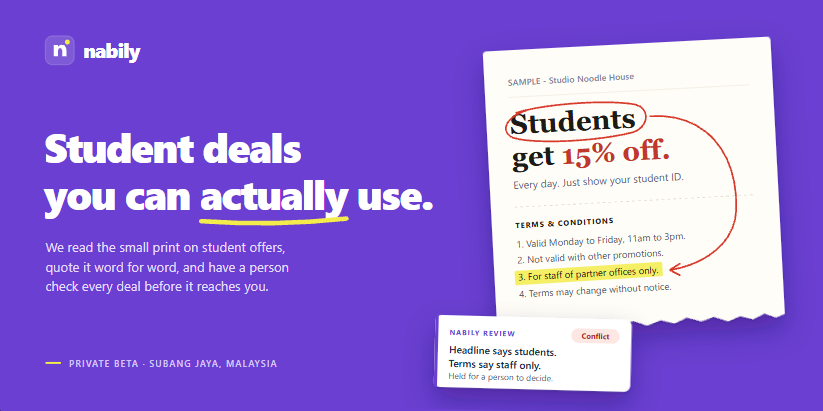
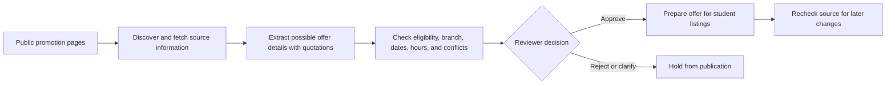

# Nabily

  

  

  <strong>Nabily is an early-stage startup helping students find local offers and understand the terms before they use them.</strong>

  <strong>Private beta</strong> &nbsp;•&nbsp; <strong>Pre-launch</strong> &nbsp;•&nbsp; Not yet available as a public service

---

## Overview

Promotions can sound simple in a headline and become more complicated in the fine print. A discount may be limited to certain students, locations, dates, or hours. Nabily is being built to make those details easier to discover, check, and understand before a student decides whether to use an offer.

The platform organizes publicly available promotion information into clear listings. It keeps supporting source evidence connected to offer details and brings uncertain or conflicting information to a person for review.

## Who uses the system

| Role | What they do |
| --- | --- |
| **Students** | Browse reviewed offers and understand the conditions that may affect whether an offer applies. |
| **Reviewers** | Check a candidate against its source, then approve it, reject it, or request clarification. |
| **Background workflow** | Finds and processes public promotion pages, extracts possible details, applies consistent checks, and rechecks sources. It does not make the final publication decision. |
| **AI services** | Help identify possible offer details from source material. Their output is treated as a suggestion and checked against evidence and rules. |
| **Database** | Stores offer, branch, evidence, and review records and provides consistent location- and time-based validity checks. |

## How the system works

1. **Discover:** the worker finds public promotion information from approved sources.
2. **Fetch and parse:** it retrieves the page within configured size and time limits and extracts readable content.
3. **Extract with evidence:** AI-assisted processing proposes offer details and keeps the supporting source quotations alongside them. Unsupported claims are not treated as confirmed facts.
4. **Validate:** fixed rules check the structured result for required details and flag conflicts, eligibility limits, dates, locations, and hours.
5. **Review:** a human reviewer checks the source and candidate information, then approves, rejects, or requests clarification.
6. **Present and recheck:** approved offers are prepared for student-facing listings. Follow-up checks help identify changed or expired source information.

Offer validity can depend on the branch and the time at which a student wants to use it. Nabily keeps those checks consistent in the data layer instead of relying on separate interpretations in each screen.

## What is built

| Capability | Purpose |
| --- | --- |
| Promotion discovery | Finds and processes publicly available offer pages. |
| Evidence-backed extraction | Keeps source quotations connected to proposed offer details. |
| Eligibility and terms checks | Identifies missing information and possible conflicts between a headline and its conditions. |
| Human review workflow | Supports approval, rejection, and clarification before publication. |
| Offer and location data | Organizes offers, participating branches, source evidence, reviews, and follow-up checks. |
| Student and reviewer web experience | The web application is in development and under review. |

## Tools and technologies

| Area | Tools | How they are used |
| --- | --- | --- |
| Backend development | Python, `uv` | Implements and manages the background service and its dependencies. |
| Workflow orchestration | LangGraph | Coordinates discovery, fetching, extraction, validation, review hand-off, and follow-up work. |
| AI integration | OpenRouter, OpenAI SDK | Calls language models to assist with structured extraction; model output is checked before use. |
| Offer discovery | Tavily | Helps find promotion pages from configured sources. |
| Page retrieval and parsing | `httpx`, Trafilatura, Beautiful Soup | Retrieves and parses web pages under request limits. |
| Data validation | Pydantic | Validates configuration and structured offer data. |
| Data storage and location queries | PostgreSQL, PostGIS, Psycopg | Stores the shared offer data and supports location-aware checks. |
| Database changes | dbmate | Applies versioned database migrations. |
| Quality and security checks | pytest, Ruff, mypy, Gitleaks, Bandit, pip-audit, GitHub Actions | Supports automated tests, code checks, secret scanning, dependency review, and continuous integration. |

## Product and security principles

- **Evidence first:** important details remain connected to the promotion source.
- **Human oversight:** a person must decide before a new or changed offer is published.
- **Uncertainty stays visible:** conflicts and missing information are flagged instead of being silently guessed.
- **Bounded source access:** page retrieval is limited to approved sources and constrained by request size and time.
- **Scoped data access:** system components use restricted database permissions and row-level controls.

## Current stage

Nabily is in private beta and pre-launch development. The backend workflow and database foundations are in place. The web application is under review, and Nabily is not currently deployed as a public service.
